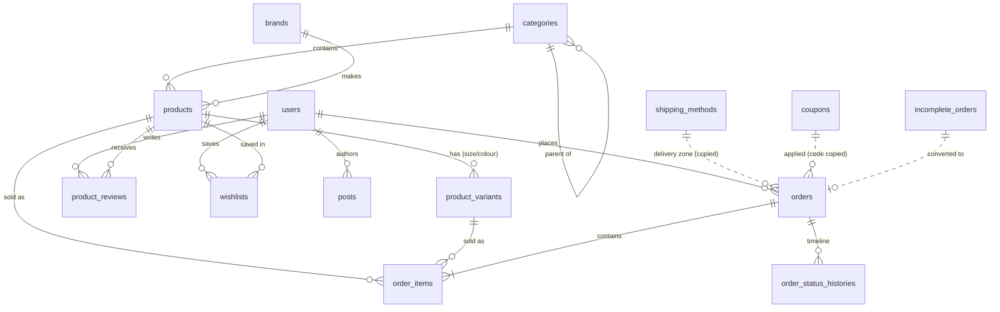

# Database diagram

The full schema is in [`database/schema.sql`](../database/schema.sql) (28 tables). The migrations are in `database/migrations/`.

Solid lines are foreign keys. Dotted lines are copied values: an order stores the shipping cost and the coupon code as they were when the order was placed, so later edits never change old orders.

## Table groups

| Group | Tables |
|---|---|
| Catalog | `categories` (nested with `parent_id`), `brands`, `products` (price, sale_price, sale_ends_at, stock, gallery/options/specifications JSON, fulltext index, soft deletes), `product_variants`, `product_reviews`, `wishlists` |
| Sales | `orders` (`order_number`, status, payment_status, transaction_id, totals), `order_items`, `order_status_histories`, `coupons`, `shipping_methods`, `incomplete_orders` (abandoned checkouts) |
| Content | `settings` (one JSON row per settings group), `home_sections` (page builder), `pages`, `posts`, `redirects` |
| Customers | `users` (`is_admin`, phone unique, email optional), `subscribers`, `contact_messages`, `password_reset_tokens` |
| Laravel | `migrations`, `cache`, `cache_locks`, `sessions`, `jobs`, `job_batches`, `failed_jobs` |

## Business rules in code

- **Stock:**
  - deducted inside a database transaction that locks the rows (`CheckoutService::place()`)
  - returned when an order is cancelled or returned (`Order::adjustStock()`)
  - a product's stock is the sum of its variants' stock (`Product::syncStockFromVariants()`)
- **Order history:** each status change is written to `order_status_histories` (`Order::booted()`)
- **COD payment:** a Cash-on-Delivery order is marked **paid** automatically when it is delivered
